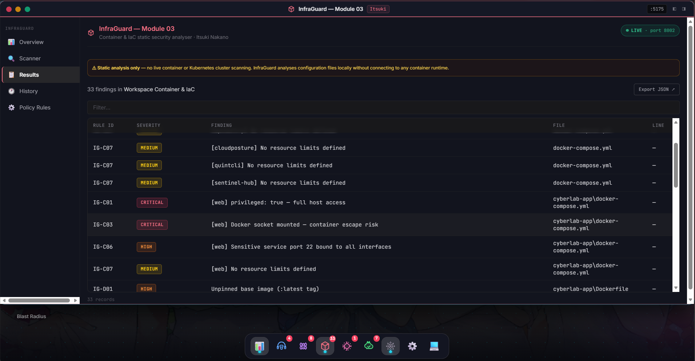
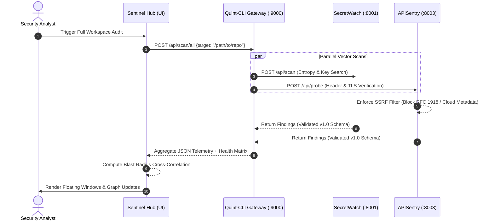

# 🛡️ QuintOS (`quint-0s`) — Cyber Command Center
### *A Modular, Local-First Cybersecurity Desktop OS & Multi-Vector Audit Platform*

<p align="center">
  
</p>

[](ARCHITECTURE.md)
[](#-visual-showcase--desktop-experience)
[](tests)
[](contracts/ssrf_guard.py)
[](LICENSE)

---

> [!NOTE]  
> **Public Portfolio Showcase:** This repository serves as the public architecture, system design, and interface showcase for **QuintOS**. The core scanning engines and heuristic detection models are maintained in a private repository to protect proprietary intellectual property and prevent malicious reuse. 
> 
> Explore the [System Architecture](#-system-architecture), [Technical Engineering Highlights](#-technical-engineering-highlights), and [Curated Core Interfaces](#-curated-code-snippets--contracts) below.

---

## 🎯 Executive Summary & Mission

**QuintOS** is a local-first, modular cybersecurity workstation that reimagines security tooling as an integrated desktop operating system rather than a fragmented set of disconnected CLI scripts or web dashboards.

### Core Philosophy
1. **Zero Data Exfiltration (Local-First):** Security audits run locally. Proprietary source code, configuration files, and credentials never touch third-party cloud analytics or SaaS vendors.
2. **Unified Blast Radius Analysis:** Rather than siloing alerts, findings across supply chains, hardcoded secrets, container infrastructure, live APIs, and cloud templates are correlated into a single interactive topological attack-graph.
3. **Deterministic Risk Scoring:** Replaces subjective alert numbers with a bounded 0–100 composite risk matrix factoring severity, confidence, and asset exposure.

---

## 📸 Visual Showcase & Desktop Experience

*QuintOS pairs a cyberpunk dark mode aesthetic (`#080b10`) with window management (drag, snap, minimize, maximize, and dynamic z-index stacking).*

| **Sentinel Hub — Unified Cyber Command Desktop** |
|:---:|
|  |
| *Unified OS desktop running floating micro-modules, blast radius graph, and live health monitors.* |

<br>

| **Module 01: SupplyWatch (`:5173`)** | **Module 02: SecretWatch (`:5174`)** |
|:---:|:---:|
|  |  |
| *PyPI/npm dependency vulnerability tracking and typosquatting detection via Levenshtein heuristics.* | *High-entropy token analysis and pattern matching with AST false-positive filters.* |

<br>

| **Module 03: InfraGuard (`:5175`)** | **Module 04: APISentry (`:5176`)** |
|:---:|:---:|
|  |  |
| *Static container analysis (Dockerfile, K8s, Compose) checking non-root execution and privilege escalation.* | *Live security header audit, CORS misconfiguration scanner, and SSRF containment engine.* |

<br>

| **Module 05: CloudPosture (`:5177`)** | **Blast Radius Graph — Cross-Vector Correlation** |
|:---:|:---:|
|  |  |
| *IaC posture verification across Terraform HCL, AWS CloudFormation, and Azure ARM templates.* | *Interactive topological graph tracing multi-hop exploit paths from leaked keys to cloud assets.* |

---

## 🏛️ System Architecture

QuintOS is built as an asynchronous microservices mesh orchestrated through a centralized gateway and visualized in a React floating-window interface.

```
                        ┌─────────────────────────────────────────────────────┐
                        │           SENTINEL HUB  (localhost:5170)            │
                        │     React 18 · Vite · Tailwind · Floating Windows   │
                        │                                                     │
                        │  ┌──────────┐  ┌──────────┐  ┌──────────────────┐  │
                        │  │OverviewWin│  │BlastRadius│  │ActivityMonitorWin│  │
                        │  └──────────┘  └──────────┘  └──────────────────┘  │
                        │        ↑ moduleFindings (React State Aggregator)    │
                        └──────────────────────────┬──────────────────────────┘
                                                   │ Direct HTTP / SSE Event Stream
            ┌───────────────────┬───────────────────┼───────────────────┬───────────────────┐
            ▼                   ▼                   ▼                   ▼                   ▼
  ┌──────────────────┐ ┌──────────────────┐ ┌──────────────────┐ ┌──────────────────┐ ┌──────────────────┐
  │  M01 SupplyWatch │ │  M02 SecretWatch │ │  M03 InfraGuard  │ │  M04 APISentry   │ │  M05 CloudPosture│
  │  🔵 Blue Accent  │ │  🟣 Purple Accent│ │  🔴 Red Accent   │ │  🩷 Pink Accent  │ │  🟢 Green Accent │
  │                  │ │                  │ │                  │ │                  │ │                  │
  │  UI  :5173       │ │  UI  :5174       │ │  UI  :5175       │ │  UI  :5176       │ │  UI  :5177       │
  │  API :8000       │ │  API :8001       │ │  API :8002       │ │  API :8003       │ │  API :8004       │
  │                  │ │                  │ │                  │ │                  │ │                  │
  │  OSV & CVE Cache │ │  Entropy Engine  │ │  K8s/Docker AST  │ │  SSRF Guard + TLS│ │  IaC Misconfig   │
  └──────────────────┘ └──────────────────┘ └──────────────────┘ └──────────────────┘ └──────────────────┘
            ▲                   ▲                   ▲                   ▲                   ▲
            └───────────────────┴───────────────────┼───────────────────┴───────────────────┘
                                                    │ Reverse Proxy Aggregator
                                         ┌──────────────────────┐
                                         │  M06 Quint-CLI GW    │
                                         │  FastAPI · :9000     │
                                         │  Async Concurrency   │
                                         └──────────────────────┘
```

### Flowchart: Asynchronous Scan Lifecycle



---

## ⚡ Technical Engineering Highlights

### 1. Hardened SSRF Protection Engine (`APISentry`)
When probing arbitrary web endpoints for TLS certificates and security headers (CSP, HSTS, CORS), tools risk becoming open Server-Side Request Forgery (SSRF) proxies. 
* **Defense Strategy:** IP pre-resolution and strict routing table verification before socket invocation.
* **Coverage:** Validates targets against all RFC 1918 private subnets (`10.0.0.0/8`, `172.16.0.0/12`, `192.168.0.0/16`), loopback (`127.0.0.0/8`, `::1`), link-local (`169.254.0.0/16`), and AWS/GCP cloud metadata IP addresses (`169.254.169.254`, `metadata.google.internal`).
* **DNS Rebinding Guard:** Resolves IP addresses immediately prior to connection, avoiding split-horizon cache poisoning.

### 2. Shannon Entropy & False-Positive Elimination (`SecretWatch`)
Static regex searching for API keys produces unmanageable false-positive rates on commit hashes and UUIDs.
* **Mathematical Entropy Filter:** Implements Shannon entropy calculation:
  $$H(X) = -\sum_{i=1}^{n} P(x_i) \log_2 P(x_i)$$
* Strings matching high-entropy signatures ($H > 4.5$) are passed through a contextual validation filter (variable naming AST, test folder exclusion, and known checksum formats) before an alert is escalated.

### 3. Multi-Format Declarative AST Engine (`InfraGuard` & `CloudPosture`)
* Rather than brittle regex on infrastructure code, parsers generate declarative syntax trees across Dockerfiles, Kubernetes manifests, and Terraform HCL.
* Validates CIS Benchmarks, non-root user enforcement (`USER nonroot`), read-only root filesystems, and unencrypted S3/Cloud Storage buckets.

### 4. Typosquatting Detection with Levenshtein Distance (`SupplyWatch`)
* Analyzes direct and transitive dependency trees against top 10,000 PyPI/npm packages.
* Calculates Damerau-Levenshtein edit distance to detect malicious homoglyphs and typo-squatted attack packages (e.g., `requsts` vs `requests`).

---

## 📜 Universal Finding Contract (`v1.0`)

All 5 micro-modules emit findings strictly compliant with this standardized JSON schema:

```json
{
  "$schema": "https://json-schema.org/draft/2020-12/schema",
  "id": "SEC-SW-2026-0042",
  "module": "SupplyWatch",
  "timestamp": "2026-11-20T06:57:00Z",
  "title": "Typosquatting Candidate Detected: requsts",
  "severity": "HIGH",
  "risk_score": 45,
  "category": "supply_chain",
  "asset": "requirements.txt:14",
  "evidence": "requsts==2.31.0 (Levenshtein distance: 1 to 'requests')",
  "description": "Package 'requsts' closely mimics high-reputation library 'requests'.",
  "remediation": "Replace 'requsts' with legitimate 'requests' from PyPI.",
  "status": "open"
}
```

---

## 🧪 Testing Rigor & Quality Engineering

QuintOS maintains an exhaustive testing suite across all Python microservices and React frontends:

```bash
$ pytest --verbose
============================= test session starts =============================
platform win32 -- Python 3.11+, pytest-8.3.4
collected 114 items

apisentry/api/tests/test_apisentry.py::TestIsPrivateTarget::test_ssrf_private_ip_blocked PASSED
apisentry/api/tests/test_apisentry.py::TestIsPrivateTarget::test_ssrf_localhost_blocked PASSED
apisentry/api/tests/test_apisentry.py::TestIsPrivateTarget::test_ssrf_cloud_metadata_blocked PASSED
apisentry/api/tests/test_apisentry.py::TestAnalyseEndpoint::test_missing_hsts_flagged PASSED
apisentry/api/tests/test_apisentry.py::TestAnalyseEndpoint::test_wildcard_cors_flagged PASSED
secretwatch/api/tests/test_entropy.py::test_shannon_entropy_thresholds PASSED
infraguard/api/tests/test_docker_parser.py::test_root_user_detection PASSED
cloudposture/api/tests/test_terraform.py::test_public_bucket_flagged PASSED
...
============================= 114 passed in 2.14s =============================
```

---

## 📂 Repository Structure

```
quint-0s-portfolio/
├── contracts/                     # Curated core abstractions & interfaces
│   ├── base_scanner.py            # Abstract scanner template method pattern
│   ├── schemas.py                 # Pydantic v2 universal contracts
│   └── ssrf_guard.py              # Production SSRF firewall module
├── tests/                         # Architectural & schema test suites
│   └── test_scanner_contracts.py  # Boundary tests & schema validation
├── screenshots/                   # High-resolution UI captures
├── ARCHITECTURE.md                # System design & threat model
└── README.md                      # Project documentation
```

---

## 👤 Author & Contact

**Nikhil Manvi**  
*Cybersecurity Specialist & Full-Stack Systems Engineer*  
- **GitHub:** [@nikhilmanvi360](https://github.com/nikhilmanvi360)  
- **Project Inquiry / Full Code Access:** Inquiries for technical evaluation, code review, or collaboration can be requested via GitHub.
