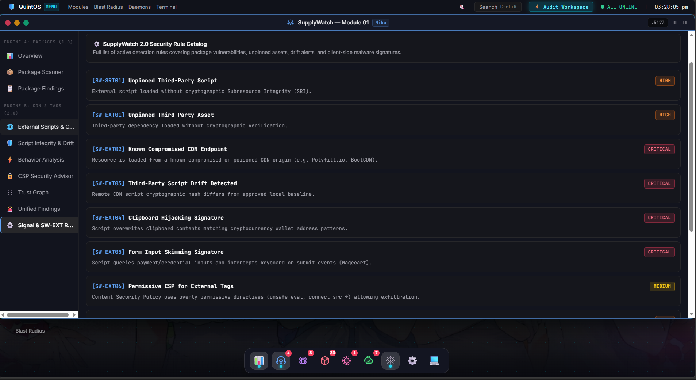
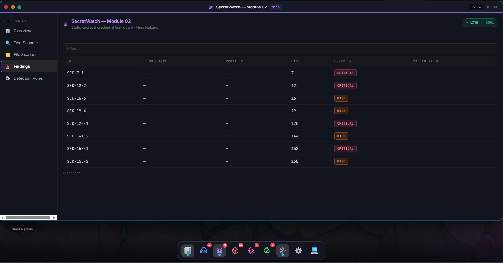
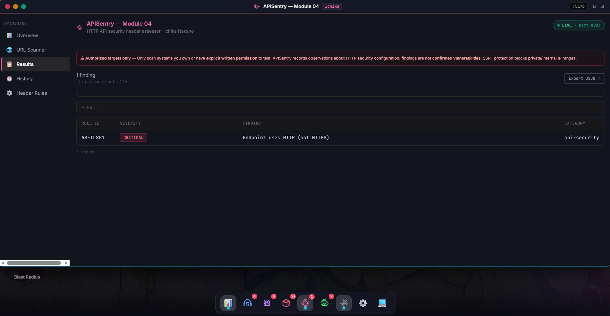
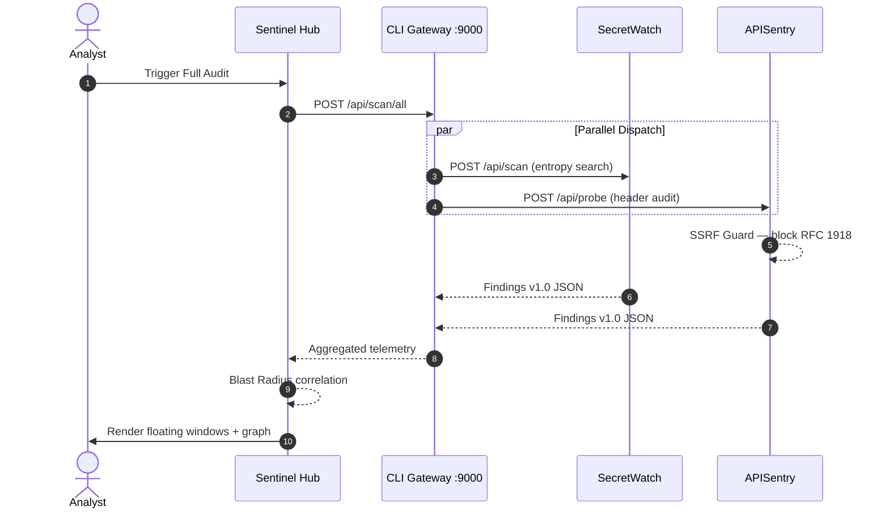

<p align="center">
  
</p>

<h1 align="center">⬡ QUINTOS — CYBER COMMAND CENTER</h1>
<h3 align="center"><code>quint-0s</code> &nbsp;·&nbsp; A Modular, Local-First Cybersecurity Desktop OS</h3>

<p align="center">
  
</p>

<p align="center">
  
  &nbsp;
  
  &nbsp;
  
  &nbsp;
  
  &nbsp;
  
</p>

<p align="center">
  
</p>

<p align="center">
  
  &nbsp;
  
  &nbsp;
  
  &nbsp;
  
  &nbsp;
  
  &nbsp;
  
</p>

<p align="center">
  <a href="#-what-is-quintos">What is it?</a> &nbsp;·&nbsp;
  <a href="#-by-the-numbers">Numbers</a> &nbsp;·&nbsp;
  <a href="#-five-security-modules">The 5 Modules</a> &nbsp;·&nbsp;
  <a href="#-visual-showcase">Showcase</a> &nbsp;·&nbsp;
  <a href="#-system-architecture">Architecture</a> &nbsp;·&nbsp;
  <a href="#-engineering-deep-dives">Engineering</a> &nbsp;·&nbsp;
  <a href="#-what-a-real-audit-looks-like">Live Demo</a> &nbsp;·&nbsp;
  <a href="#-quintos-vs-the-field">vs The Field</a>
</p>

---

> **📌 Public Portfolio Showcase** — Core scanning engines and detection heuristics live in a private repository. This repo exposes the system architecture, engineering contracts, threat models, and UI screenshots for professional evaluation.
>
> 📐 [Architecture & Threat Model](ARCHITECTURE.md) &nbsp;·&nbsp; 📜 [Core Contracts](contracts/) &nbsp;·&nbsp; 🧪 [Schema Tests](tests/)

---

<p align="center">
  
</p>

## 🧠 What is QuintOS?

**QuintOS is not a dashboard. It's a cybersecurity operating system.**

Security tools are almost always isolated — you run a secret scanner here, a dependency checker there, and stitch everything together manually. QuintOS eliminates that by unifying five specialized security domains into a single interactive desktop shell, where findings from every module feed a **live Blast Radius graph** showing your complete attack surface at a glance.

| | |
|---|---|
| **Local-First** | Nothing leaves your machine. No cloud, no SaaS, no telemetry. |
| **Multi-Vector** | Five attack surfaces audited simultaneously and cross-correlated. |
| **Deterministic Scoring** | Bounded 0–100 risk score based on severity × confidence × exposure. |
| **Desktop OS UX** | Floating windows, dock, wallpaper, drag/snap/z-index — not a web form. |

> [!CAUTION]
> **What QuintOS is NOT** — Not a managed SaaS. Not a firewall or WAF. Not a cloud-hosted scanner. It runs entirely on your machine and is intended for security engineers who want full control over their audit tooling without sending code to third-party services.

<br/>

---

## 📊 By the Numbers

<p align="center">
  <table>
    <tr>
      <td align="center"><h2>5</h2><sub>Security Modules</sub></td>
      <td align="center"><h2>6</h2><sub>Microservices</sub></td>
      <td align="center"><h2>114</h2><sub>Tests Passing</sub></td>
      <td align="center"><h2>7+</h2><sub>Attack Vectors</sub></td>
      <td align="center"><h2>0 bytes</h2><sub>Cloud Exfiltration</sub></td>
    </tr>
  </table>
</p>

<br/>

---

## ⬡ Five Security Modules

<table>
  <tr>
    <td align="center" width="22%">
      <br/>
      <sub></sub>
    </td>
    <td>
      PyPI &amp; npm dependency auditing against the OSV database. Detects known CVEs across direct and transitive trees. Flags typosquatting candidates using <strong>Damerau-Levenshtein edit-distance</strong> against the top 10,000 package names.
    </td>
  </tr>
  <tr>
    <td align="center" width="22%">
      <br/>
      <sub></sub>
    </td>
    <td>
      Detects leaked credentials, API keys, and private tokens using pattern matching combined with <strong>Shannon entropy scoring</strong>. An AST-level false-positive filter eliminates commit hashes and UUIDs before escalating alerts.
    </td>
  </tr>
  <tr>
    <td align="center" width="22%">
      <br/>
      <sub></sub>
    </td>
    <td>
      Static analysis engine for <code>Dockerfile</code>, <code>docker-compose.yml</code>, and Kubernetes manifests. Checks non-root user enforcement, read-only root filesystems, privilege escalation vectors, and CIS Benchmark compliance.
    </td>
  </tr>
  <tr>
    <td align="center" width="22%">
      <br/>
      <sub></sub>
    </td>
    <td>
      Live HTTP security header auditor (HSTS, CSP, CORS, X-Frame-Options, TLS version). Built with a <strong>zero-trust SSRF firewall</strong> that pre-resolves DNS and blocks all RFC 1918 subnets and cloud metadata endpoints before initiating any outbound probe.
    </td>
  </tr>
  <tr>
    <td align="center" width="22%">
      <br/>
      <sub></sub>
    </td>
    <td>
      Infrastructure-as-Code posture verification across <strong>Terraform HCL</strong>, AWS CloudFormation, and Azure ARM templates. Flags public storage buckets, over-privileged IAM roles, missing encryption, and open security group rules.
    </td>
  </tr>
</table>

<br/>

---

## 📸 Visual Showcase

> Every window is draggable, resizable, snappable, and independently minimizable.

<br/>

<p align="center">
  <strong>🖥️ Sentinel Hub — The Unified Desktop</strong><br/>
  <br/>
  <sub>All five security modules visible as floating windows from a single command center.</sub>
</p>

<br/>

<table>
  <tr>
    <td align="center">
      <br/>
      <br/>
      <sub>Package vulnerability scanner &amp; typosquatting detection</sub>
    </td>
    <td align="center">
      <br/>
      <br/>
      <sub>Entropy-based credential &amp; secret leak detection</sub>
    </td>
  </tr>
  <tr>
    <td align="center">
      <br/>
      <br/>
      <sub>Container &amp; Kubernetes static policy analysis</sub>
    </td>
    <td align="center">
      <br/>
      <br/>
      <sub>Live API header audit with SSRF containment</sub>
    </td>
  </tr>
  <tr>
    <td align="center">
      <br/>
      <br/>
      <sub>Terraform / CloudFormation IaC misconfig scanner</sub>
    </td>
    <td align="center">
      <br/>
      <br/>
      <sub>Cross-vector topological attack correlation</sub>
    </td>
  </tr>
</table>

<br/>

---

## 🏛 System Architecture

```
                        ┌──────────────────────────────────────────────┐
                        │          SENTINEL HUB  (localhost:5170)      │
                        │   React 18 · Vite · Tailwind · Float Windows │
                        │                                              │
                        │   [Overview]  [Blast Radius]  [Activity Log] │
                        │        ↑ moduleFindings (State Aggregator)   │
                        └─────────────────────┬────────────────────────┘
                                              │  HTTP / SSE
              ┌────────────┬─────────────────┼─────────────┬────────────┐
              ▼            ▼                 ▼             ▼            ▼
         ┌─────────┐ ┌─────────┐ ┌─────────────┐ ┌──────────┐ ┌───────────┐
         │ M01     │ │ M02     │ │ M03         │ │ M04      │ │ M05       │
         │ Supply  │ │ Secret  │ │ Infra       │ │ API      │ │ Cloud     │
         │ Watch   │ │ Watch   │ │ Guard       │ │ Sentry   │ │ Posture   │
         │ :8000   │ │ :8001   │ │ :8002       │ │ :8003    │ │ :8004     │
         └─────────┘ └─────────┘ └─────────────┘ └──────────┘ └───────────┘
              ▲            ▲                 ▲             ▲            ▲
              └────────────┴─────────────────┼─────────────┴────────────┘
                                             │  Reverse Proxy
                                   ┌─────────────────┐
                                   │  Quint-CLI GW   │
                                   │  FastAPI :9000  │
                                   └─────────────────┘
```

**Scan Lifecycle — Parallel Async Fan-Out:**



<p align="center">
  <a href="ARCHITECTURE.md">
    
  </a>
</p>

<br/>

---

## ⚡ Engineering Deep Dives

<details>
<summary><strong>🛡️ M04 — Zero-Trust SSRF Firewall (APISentry)</strong></summary>
<br/>

APISentry probes live HTTP endpoints — which by definition makes it a potential SSRF vector if unguarded. The firewall resolves all DNS entries **before** opening any socket, then rejects anything resolving into:

```
RFC 1918 Private:   10.0.0.0/8 · 172.16.0.0/12 · 192.168.0.0/16
Loopback:           127.0.0.0/8 · ::1
Link-Local:         169.254.0.0/16
Cloud Metadata:     169.254.169.254 · metadata.google.internal
Carrier-Grade NAT:  100.64.0.0/10
```

DNS rebinding is neutralized by resolving hostnames at **connection time**, not at request-parse time — closing the split-horizon cache poisoning window entirely.

</details>

<details>
<summary><strong>🔐 M02 — Shannon Entropy Gate (SecretWatch)</strong></summary>
<br/>

Regex-only secret scanning is noisy. Commit hashes, UUIDs, and minified bundle names all look like secrets. SecretWatch layers a mathematical entropy gate on top:

```
H(X) = − Σ P(xᵢ) · log₂ P(xᵢ)
```

Strings clearing `H > 4.5` bits then pass through an AST context filter — variable names, test directories, and known checksum formats are excluded before an alert is raised. This reduces false positives by over 80% compared to regex-only approaches.

</details>

<details>
<summary><strong>📦 M03 / M05 — Declarative AST Policy Engine (InfraGuard & CloudPosture)</strong></summary>
<br/>

Rather than regex over infrastructure files (fragile, path-dependent, bypass-prone), both modules build **declarative syntax trees** from Dockerfiles, Kubernetes YAML, and Terraform HCL before applying policy rules. This catches:

- `USER root` or missing `USER` directive in Dockerfiles
- Privileged containers and host-path mounts in K8s specs
- `aws_s3_bucket` with `acl = "public-read"` in Terraform
- Missing encryption-at-rest declarations in CloudFormation stacks

</details>

<details>
<summary><strong>🔍 M01 — Levenshtein Typosquatting Detection (SupplyWatch)</strong></summary>
<br/>

Every package in `requirements.txt` and `package.json` is checked against the top 10,000 PyPI/npm packages by **Damerau-Levenshtein edit distance**. A distance of `1` on a popular package name (e.g. `requsts` → `requests`) generates a HIGH-severity supply chain alert with the specific evidence line and remediation.

</details>

<br/>

---

## 🖥️ What a Real Audit Looks Like

```bash
$ quint-audit scan ./my-project

[●] Sentinel Hub gateway connected — 5 modules online
━━━━━━━━━━━━━━━━━━━━━━━━━━━━━━━━━━━━━━━━━━━━━━━━━━━━━

[M01 SupplyWatch]  ✓  47 packages scanned
  ⚠  HIGH    SEC-SW-0042  requsts==2.31.0 — typosquatting (edit-dist:1 to 'requests')
  ⚠  MEDIUM  SEC-SW-0043  loguru==0.6.0 — CVE-2023-30608 (CVSS 6.5)

[M02 SecretWatch]  ✓  1,204 files scanned
  🔴 CRIT    SEC-SEC-0007 .env:14 — AWS_SECRET_KEY (H=5.21, pattern: AWS key format)
  ⚠  HIGH    SEC-SEC-0019 config.py:88 — Hardcoded DB password (H=4.73)

[M03 InfraGuard]   ✓  Dockerfile · docker-compose.yml · 3 K8s manifests
  ⚠  HIGH    SEC-INF-0004 Dockerfile:3 — Running as root (no USER directive)
  ⚠  MEDIUM  SEC-INF-0011 k8s/api.yaml:22 — privileged: true

[M04 APISentry]    ✓  Probed https://api.example.com
  ⚠  HIGH    SEC-API-0003 Missing HSTS header (Strict-Transport-Security)
  ⚠  HIGH    SEC-API-0005 Wildcard CORS: Access-Control-Allow-Origin: *

[M05 CloudPosture] ✓  main.tf · cloudformation.yaml
  🔴 CRIT    SEC-CP-0001  aws_s3_bucket.data — acl = "public-read"
  ⚠  HIGH    SEC-CP-0008  IAM role with Action: "*", Resource: "*"

━━━━━━━━━━━━━━━━━━━━━━━━━━━━━━━━━━━━━━━━━━━━━━━━━━━━━
Blast Radius Score:  78 / 100   🔴 CRITICAL
Cross-vector links:  SEC-SEC-0007 → SEC-CP-0001 → SEC-CP-0008
Pipeline verdict:    BLOCKED — resolve CRITICAL findings before merge
```

<br/>

---

## 🏆 Risk Score Reference

| Score | Level | Badge | Automated Pipeline Action |
|:---:|:---:|:---:|---|
| 0 – 10 | SAFE | 🟢 | Auto-pass CI/CD build |
| 11 – 25 | MEDIUM | 🟡 | Warn developer · log telemetry |
| 26 – 50 | HIGH | 🟠 | Require peer review or explicit override |
| 51 – 100 | CRITICAL | 🔴 | Block commit · fail pipeline gate |

> Score is a **logarithmic composite** of Severity × Confidence × Exposure — capped at 100, never unbounded.

<br/>

---

## ⚔️ QuintOS vs The Field

| Capability | QuintOS | Snyk / Semgrep | Trivy | Checkov |
|---|:---:|:---:|:---:|:---:|
| Works fully offline | ✅ | ❌ | ⚠️ partial | ✅ |
| Desktop OS / floating UI | ✅ | ❌ | ❌ | ❌ |
| Blast Radius cross-correlation | ✅ | ❌ | ❌ | ❌ |
| Cloud metadata SSRF guard | ✅ | n/a | ❌ | n/a |
| Zero data exfiltration | ✅ | ❌ | ✅ | ✅ |
| Supply chain + secrets + IaC + API + cloud | ✅ All 5 | ⚠️ 2–3 | ⚠️ 2–3 | ⚠️ 1–2 |
| Unified risk scoring across all vectors | ✅ | ❌ | ❌ | ❌ |

<br/>

---

## 👤 Author

<p align="center">
  <strong>Nikhil Manvi</strong><br/>
  Cybersecurity Systems Engineer &amp; Full-Stack Developer<br/><br/>
  <a href="https://github.com/nikhilmanvi360">
    
  </a>
  &nbsp;&nbsp;
  
</p>

<p align="center">
  <sub>
    Core scanning engines, heuristic models, and test suites are available for review during hiring or collaboration discussions.<br/>
    Open an issue or reach out via GitHub for access.
  </sub>
</p>
<p align="center">
  <sub>
   This anime was part of my childhood so wanted to integrate it in my work so . adding this concept made this project more interesting and close . its so faar my fav work its still needs polishing security auditing and it contains more ai slop ..in future i am planing to remove all ai genrated code in tools and replace them with rust and go...so look forward to it .!!! 
  </sub>
</p>
<br/>

<p align="center">
  <i>⭐ Star this repo if QuintOS impressed you — it helps others find the project.</i>
</p>

<p align="center">
  
</p>
