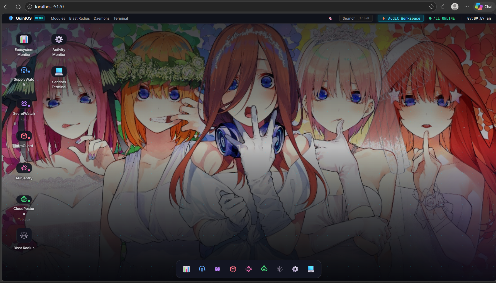
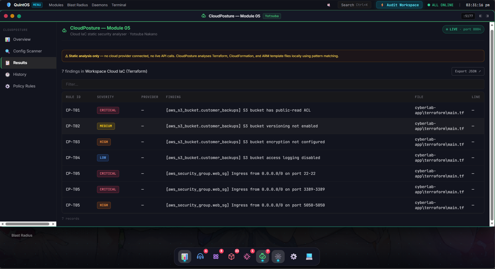
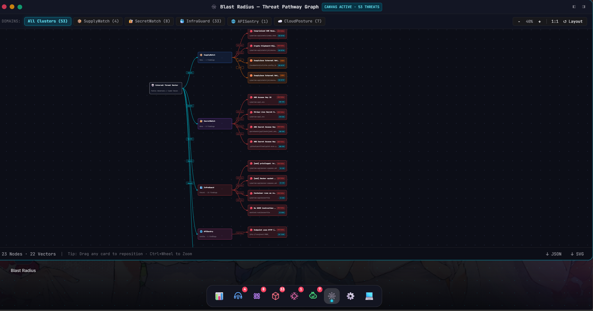
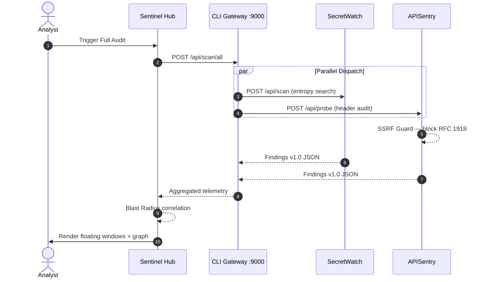

<p align="center">
  
</p>

<h1 align="center">⬡ QUINTOS — CYBER COMMAND CENTER</h1>
<h3 align="center"><code>quint-0s</code> &nbsp;·&nbsp; A Modular, Local-First Cybersecurity Desktop OS</h3>

<p align="center">
  
  &nbsp;
  
  &nbsp;
  
  &nbsp;
  
  &nbsp;
  
</p>

<p align="center">
  <a href="#-what-is-quintos">What is it?</a> &nbsp;·&nbsp;
  <a href="#-five-security-modules">The 5 Modules</a> &nbsp;·&nbsp;
  <a href="#-visual-showcase">Visual Showcase</a> &nbsp;·&nbsp;
  <a href="#-system-architecture">Architecture</a> &nbsp;·&nbsp;
  <a href="#-engineering-deep-dives">Engineering</a> &nbsp;·&nbsp;
  <a href="#-test-suite">Tests</a>
</p>

---

> **📌 Public Portfolio Showcase** — The core scanning engines and detection heuristics live in a private repository. This repo exposes the system architecture, engineering contracts, threat models, and UI screenshots for professional evaluation.

---

## 🧠 What is QuintOS?

**QuintOS is not a dashboard. It's a cybersecurity operating system.**

Security tools are almost always isolated — you run a secret scanner here, a dependency checker there, and stitch everything together manually. QuintOS eliminates that by unifying five specialized security domains into a single interactive desktop shell, where findings from every module feed a **live Blast Radius graph** showing your complete attack surface at a glance.

| | |
|---|---|
| **Local-First** | Nothing leaves your machine. No cloud, no SaaS, no telemetry. |
| **Multi-Vector** | Five attack surfaces audited simultaneously and correlated. |
| **Deterministic Scoring** | Bounded 0–100 risk score based on severity × confidence × exposure. |
| **Desktop OS UX** | Floating windows, dock, wallpaper, drag/snap/z-index — not a web form. |

<br/>

---

## ⬡ Five Security Modules

<table>
  <tr>
    <td align="center" width="20%">
      <strong>🔵 M01</strong><br/>
      <strong>SupplyWatch</strong><br/>
      <sub>:5173 / :8000</sub>
    </td>
    <td>
      PyPI &amp; npm dependency auditing against the OSV database. Detects known CVEs across direct and transitive trees. Flags typosquatting candidates using <strong>Damerau-Levenshtein edit-distance</strong> against the top 10,000 package names.
    </td>
  </tr>
  <tr>
    <td align="center" width="20%">
      <strong>🟣 M02</strong><br/>
      <strong>SecretWatch</strong><br/>
      <sub>:5174 / :8001</sub>
    </td>
    <td>
      Detects leaked credentials, API keys, and private tokens using pattern matching combined with <strong>Shannon entropy scoring</strong>. An AST-level false-positive filter eliminates commit hashes and UUIDs before escalating alerts.
    </td>
  </tr>
  <tr>
    <td align="center" width="20%">
      <strong>🔴 M03</strong><br/>
      <strong>InfraGuard</strong><br/>
      <sub>:5175 / :8002</sub>
    </td>
    <td>
      Static analysis engine for <code>Dockerfile</code>, <code>docker-compose.yml</code>, and Kubernetes manifests. Checks non-root user enforcement, read-only root filesystems, privilege escalation vectors, and CIS Benchmark compliance.
    </td>
  </tr>
  <tr>
    <td align="center" width="20%">
      <strong>🩷 M04</strong><br/>
      <strong>APISentry</strong><br/>
      <sub>:5176 / :8003</sub>
    </td>
    <td>
      Live HTTP security header auditor (HSTS, CSP, CORS, X-Frame-Options, TLS version). Built with a <strong>zero-trust SSRF firewall</strong> that pre-resolves DNS and blocks all RFC 1918 subnets and cloud metadata endpoints before initiating any outbound probe.
    </td>
  </tr>
  <tr>
    <td align="center" width="20%">
      <strong>🟢 M05</strong><br/>
      <strong>CloudPosture</strong><br/>
      <sub>:5177 / :8004</sub>
    </td>
    <td>
      Infrastructure-as-Code posture verification across <strong>Terraform HCL</strong>, AWS CloudFormation, and Azure ARM templates. Flags public storage buckets, over-privileged IAM roles, missing encryption, and open security group rules.
    </td>
  </tr>
</table>

<br/>

---

## 📸 Visual Showcase

> Every window is draggable, resizable, snappable, and independently minimizable.

<br/>

<p align="center">
  <strong>🖥️ Sentinel Hub — The Unified Desktop</strong><br/>
  
  <sub>All five security modules visible as floating windows from a single command center.</sub>
</p>

<br/>

<table>
  <tr>
    <td align="center">
      <br/>
      <strong>🔵 M01 — SupplyWatch</strong><br/>
      <sub>Package vulnerability scanner &amp; typosquatting detection</sub>
    </td>
    <td align="center">
      <br/>
      <strong>🟣 M02 — SecretWatch</strong><br/>
      <sub>Entropy-based credential &amp; secret leak detection</sub>
    </td>
  </tr>
  <tr>
    <td align="center">
      <br/>
      <strong>🔴 M03 — InfraGuard</strong><br/>
      <sub>Container &amp; Kubernetes static policy analysis</sub>
    </td>
    <td align="center">
      <br/>
      <strong>🩷 M04 — APISentry</strong><br/>
      <sub>Live API header audit with SSRF containment</sub>
    </td>
  </tr>
  <tr>
    <td align="center">
      <br/>
      <strong>🟢 M05 — CloudPosture</strong><br/>
      <sub>Terraform / CloudFormation IaC misconfig scanner</sub>
    </td>
    <td align="center">
      <br/>
      <strong>🩵 Blast Radius Graph</strong><br/>
      <sub>Cross-vector topological attack correlation</sub>
    </td>
  </tr>
</table>

<br/>

---

## 🏛 System Architecture

```
                        ┌──────────────────────────────────────────────┐
                        │          SENTINEL HUB  (localhost:5170)      │
                        │   React 18 · Vite · Tailwind · Float Windows │
                        │                                              │
                        │   [Overview]  [Blast Radius]  [Activity Log] │
                        │        ↑ moduleFindings (State Aggregator)   │
                        └─────────────────────┬────────────────────────┘
                                              │  HTTP / SSE
              ┌────────────┬─────────────────┼─────────────┬────────────┐
              ▼            ▼                 ▼             ▼            ▼
         ┌─────────┐ ┌─────────┐ ┌─────────────┐ ┌──────────┐ ┌───────────┐
         │ M01     │ │ M02     │ │ M03         │ │ M04      │ │ M05       │
         │ Supply  │ │ Secret  │ │ Infra       │ │ API      │ │ Cloud     │
         │ Watch   │ │ Watch   │ │ Guard       │ │ Sentry   │ │ Posture   │
         │ :8000   │ │ :8001   │ │ :8002       │ │ :8003    │ │ :8004     │
         └─────────┘ └─────────┘ └─────────────┘ └──────────┘ └───────────┘
              ▲            ▲                 ▲             ▲            ▲
              └────────────┴─────────────────┼─────────────┴────────────┘
                                             │  Reverse Proxy
                                   ┌─────────────────┐
                                   │  Quint-CLI GW   │
                                   │  FastAPI :9000  │
                                   └─────────────────┘
```

**Scan Lifecycle — Parallel Async Fan-Out:**



<br/>

---

## ⚡ Engineering Deep Dives

### 🛡 SSRF Firewall — APISentry

APISentry probes live HTTP endpoints, which by definition makes it a potential SSRF vector. The firewall resolves all DNS entries **before** opening any socket, then rejects anything resolving into:

```
RFC 1918 Private:   10.0.0.0/8 · 172.16.0.0/12 · 192.168.0.0/16
Loopback:           127.0.0.0/8 · ::1
Link-Local:         169.254.0.0/16
Cloud Metadata:     169.254.169.254 · metadata.google.internal
Carrier-Grade NAT:  100.64.0.0/10
```

DNS rebinding is neutralized by resolving hostnames at connection time, not at request-parse time.

---

### 🔐 Shannon Entropy — SecretWatch

Regex-only secret scanning is noisy. Commit hashes, UUIDs, and minified bundle names all look like secrets. SecretWatch layers a mathematical entropy gate on top:

```
H(X) = − Σ P(xᵢ) · log₂ P(xᵢ)
```

Strings clearing `H > 4.5` bits then pass through an AST context filter — variable names, test directories, and known checksum formats are excluded before an alert is raised.

---

### 📦 AST-Based Policy Engine — InfraGuard & CloudPosture

Rather than regex over infrastructure files (fragile, path-dependent, bypass-prone), both modules build **declarative syntax trees** from Dockerfiles, Kubernetes YAML, and Terraform HCL before applying policy rules. This catches:

- `USER root` or missing `USER` directive in Docker
- Privileged containers and host-path mounts in K8s
- `aws_s3_bucket` with `acl = "public-read"` in Terraform
- Missing encryption-at-rest declarations in CloudFormation

---

### 🔍 Typosquatting — SupplyWatch

Every package in `requirements.txt` and `package.json` is checked against the top 10,000 PyPI/npm packages by **Damerau-Levenshtein edit distance**. A distance of `1` on a popular package name (e.g. `requsts` → `requests`) generates a HIGH-severity supply chain alert.

<br/>

---

## 📜 Universal Finding Contract

Every module emits the same machine-readable schema — no custom parsing per tool:

```json
{
  "id": "SEC-SW-2026-0042",
  "module": "SupplyWatch",
  "title": "Typosquatting Candidate: requsts",
  "severity": "HIGH",
  "risk_score": 45,
  "category": "supply_chain",
  "asset": "requirements.txt:14",
  "evidence": "requsts==2.31.0  (edit distance 1 from 'requests')",
  "remediation": "Replace with 'requests' from PyPI.",
  "status": "open",
  "timestamp": "2026-11-20T06:57:00Z"
}
```

**Risk Score Formula:** bounded at 100, computed as a logarithmic composite of `severity` × `confidence` × `exposure` — no unbounded summation.

<br/>

---

## 🧪 Test Suite

Showcased contract & SSRF boundary tests run cleanly against the public interfaces:

```bash
$ cd docs/showcase-portfolio && pytest -v

============================= test session starts =============================
platform win32 — Python 3.14, pytest-8.3.4

tests/test_scanner_contracts.py::test_valid_security_finding_contract        PASSED
tests/test_scanner_contracts.py::test_risk_score_boundary_enforcement[-1]    PASSED
tests/test_scanner_contracts.py::test_risk_score_boundary_enforcement[101]   PASSED
tests/test_scanner_contracts.py::test_risk_score_boundary_enforcement[250]   PASSED
tests/test_scanner_contracts.py::test_ssrf_disallowed_targets[10.0.0.1]     PASSED
tests/test_scanner_contracts.py::test_ssrf_disallowed_targets[192.168.1.254] PASSED
tests/test_scanner_contracts.py::test_ssrf_disallowed_targets[172.16.5.10]  PASSED
tests/test_scanner_contracts.py::test_ssrf_disallowed_targets[169.254.169.254] PASSED
tests/test_scanner_contracts.py::test_ssrf_disallowed_targets[metadata.google.internal] PASSED
tests/test_scanner_contracts.py::test_ssrf_disallowed_targets[localhost]     PASSED
tests/test_scanner_contracts.py::test_ssrf_disallow_unsupported_schemes      PASSED
tests/test_scanner_contracts.py::test_audit_target_default_values            PASSED

============================= 12 passed in 0.14s ==============================
```

The full private test suite (across all 5 modules + gateway) covers **114 tests** — available on request during technical review.

<br/>

---

## 📂 Repo Structure

```
quint-0s-portfolio/
├── screenshots/                  ← Full-resolution UI captures
│   ├── wallpaper.png             ← Sentinel Hub desktop
│   ├── supplywatch.png           ← M01 supply chain audit
│   ├── secretwatch.png           ← M02 entropy detection
│   ├── infraguard.png            ← M03 container hygiene
│   ├── apisentry.png             ← M04 live API header audit
│   ├── cloudposture.png          ← M05 IaC misconfig scan
│   └── blast-radius.png          ← Topological attack graph
│
├── contracts/                    ← Curated public interfaces
│   ├── schemas.py                ← Pydantic v2 universal contracts
│   ├── base_scanner.py           ← Abstract async scanner pattern
│   └── ssrf_guard.py             ← SSRF firewall (production)
│
├── tests/
│   └── test_scanner_contracts.py ← Boundary & schema validation
│
├── ARCHITECTURE.md               ← STRIDE threat model + DFDs
├── pytest.ini
└── LICENSE                       ← Proprietary portfolio evaluation
```

<br/>

---

## 👤 Author

<p align="center">
  <strong>Nikhil Manvi</strong><br/>
  Cybersecurity Systems Engineer &amp; Full-Stack Developer<br/><br/>
  <a href="https://github.com/nikhilmanvi360">
    
  </a>
  &nbsp;&nbsp;
  
</p>

<p align="center">
  <sub>
    Core scanning engines, heuristic models, and test suites are available for review during hiring or collaboration discussions.<br/>
    Open an issue or reach out via GitHub for access.
  </sub>
</p>

<br/>

<p align="center">
  
</p>
